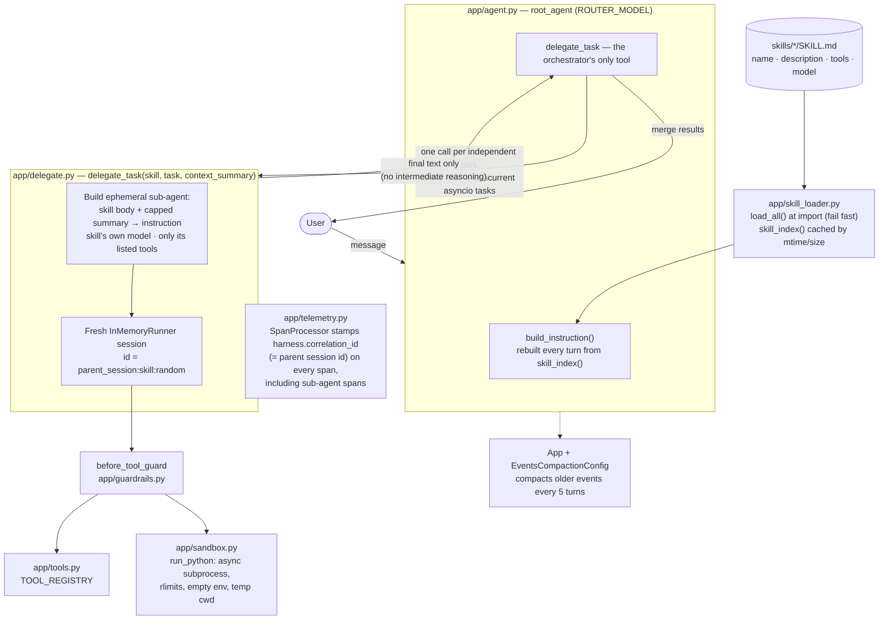

# harness-demo: a generic agent harness on Google ADK

One orchestrator agent plus Markdown **skills**. Business workflows live in `skills/*/SKILL.md`; the
Python harness is written once. Developed and tested on ADK 2.13 (needs `google-adk>=1.17` for built-in OpenTelemetry).

| Concern | Technique | Where |
|---|---|---|
| Context degradation | Compaction | `EventsCompactionConfig` in `app/agent.py` |
| | Progressive loading | `app/skill_loader.py`: index in the prompt, body loaded on delegation |
| | Context isolation | `app/delegate.py`: fresh sub-agent session, only the final answer returns |
| | Parent-to-child context | `context_summary` argument of `delegate_task`, capped |
| Security | Sandbox (filesystem, compute) | `app/sandbox.py` |
| | Guardrails | `app/guardrails.py` (`before_tool_callback`) |
| | Identity | Agent Identity + `deploy/iam.sh` |
| Generalizability | Infra once, logic in Markdown | `skills/*/SKILL.md`, model per skill |
| Observability | End-to-end tracing | `app/telemetry.py`, spans in `app/delegate.py` |
| Latency | Direct answers, Flash router, parallel fan-out | `app/agent.py`, `app/config.py` |

## Architecture



## How a request flows

```
User: "Can order C300 be refunded, and which region grew faster Aug-Oct?"
  orchestrator (fast Flash model) sees the skill INDEX (one line per skill)
  -> two independent parts, so ONE turn with TWO delegate_task calls (run concurrently):
       delegate_task("refund-policy",  task, context_summary_1)     delegate_task("sales-analysis", task, context_summary_2)
         own session, skill's model, only its tools                   own session, Pro model, its tools
         returns one short answer                                     returns one short answer
  -> orchestrator merges the two answers
Trivial messages ("hi", "what can you do?") are answered directly with no delegation.
```

## Skills

```
---
name: sales-analysis                      # required; must equal the folder name
description: Analyze sales by region...   # required; this is the line in the index
tools: run_sales_query, run_python        # optional; names from TOOL_REGISTRY in app/tools.py
model: gemini-2.5-pro                     # optional; must be in ALLOWED_MODELS (app/config.py)
---
Steps and rules in plain Markdown...
```

- **Model per skill.** Omit `model:` to use `DEFAULT_MODEL`. A model not on the allowlist fails loudly. The allowlist is in code, so a skill author cannot widen it.
- **Validated at load time.** Unknown tool, disallowed model, unknown or misspelled key (`modle:`), missing key, or name not matching the folder all raise `SkillError`. `app/agent.py` loads every skill at import, so a bad file stops startup. At runtime a bad file only hides that one skill (logged at ERROR); the others keep working.
- **Cached.** Each file is parsed once and re-parsed when its mtime or size changes, or after a restart. Validation re-runs every time (it is cheap) so it always sees the current registry and allowlist. The orchestrator's skill index is rebuilt each turn from the cache, so edits show up without a restart.
- **Skill files are a security surface.** Whoever can edit one changes an agent's instructions, tools and model. Keep `skills/` under version control with required review (for example a CODEOWNERS rule).
- **Tools stay plain Python** in `app/tools.py`, registered by name. Skills only reference names, so a tool can later move behind an MCP server without touching any skill.

## Passing context to a sub-agent

`delegate_task(skill_name, task, context_summary)`. The orchestrator is instructed to write a fresh, tailored summary per call (overall goal, what is established, why this skill) and to leave out anything sensitive the skill does not need. The summary is capped at `MAX_CONTEXT_SUMMARY_CHARS` (600); longer text is truncated and the tool result carries a `warnings` entry so the orchestrator learns. It goes into the sub-agent's instruction (labelled as background, not instructions) and into its session state.

Result `status` is one of `ok`, `empty`, `unknown_skill`, `invalid_skill`, `timeout`, `error`. A failed part is reported, never raised, so one failure does not abort the others.

Not implemented: reusing ADK's running compaction summary instead of generating a summary per call (listed as optional in the plan).

## Parallel delegation

When a request has independent parts the orchestrator emits one `delegate_task` call per part in the same turn. ADK runs each tool call as its own asyncio task, and `delegate_task` is async with no shared mutable state, so they overlap. Only final answers return to the orchestrator, which merges them.

Worth knowing: ADK runs **sync** tools directly on the event loop by default. A slow sync tool (a blocking DB call, `subprocess.run`) would freeze every other delegation. That is why `run_python` and the sandbox are async, and why real tools that do I/O should be `async def`.

## Tracing

Each delegation emits a `harness.delegate` span with: `harness.skill`, `harness.model`, `harness.tools_granted`, `harness.status`, `harness.duration_ms`, `harness.setup_ms` (the harness's own overhead: skill load, agent build, session create), `harness.run_ms` (the sub-agent's model and tool time), and `harness.summary_chars` / `harness.summary_truncated`. Logs carry the same `correlation_id` and never include task or summary text.

The **correlation ID is the parent session ID**. It is stamped on every span that starts during a delegation, including the spans ADK creates for the sub-agent, by a span processor (`app/telemetry.py`). It is also in the sub-agent's session state and its session ID (`<parent session>:<skill>:<random>`).

Turn on export:

```bash
adk web --otel_to_cloud        # spans to Cloud Trace, logs to Cloud Logging (needs a GCP project and credentials)
```

Check it in Cloud Trace (do this once; do not assume):
1. Run a two-part question, open the trace for that request.
2. Each `harness.delegate` span should sit under the orchestrator's `execute_tool delegate_task` span, with the sub-agent's `call_llm` / `execute_tool` spans beneath it.
3. The two delegate spans should overlap in time (that is the parallelism).
4. Filter on `harness.correlation_id = <session id>` to see the whole flow in one query.
5. Compare `harness.setup_ms` with `harness.run_ms` to see the delegation overhead.

`tests/test_delegate.py` already proves points 2 to 4 in-process with an in-memory exporter, so the code is right. It cannot prove how Cloud Trace renders them.

## Latency

- Trivial and conversational messages are answered directly (see the orchestrator instruction).
- The router runs on `ROUTER_MODEL` (Flash). Simple skills use Flash; heavy ones declare Pro.
- Each delegation adds model round trips (a few seconds). Measure with the trace attributes above before optimizing further.

## Evals (agents-cli)

```
tests/eval/datasets/skill-selection-dataset.json   8 cases: one per skill, 2 multi-intent, 1 "status only" over-trigger guard, 2 no-delegation
tests/eval/eval_config.yaml                        runs the skill_selection metric
tests/eval/skill_selection.py                      deterministic custom metric, no judge model
```

```bash
agents-cli eval run --dataset tests/eval/datasets/skill-selection-dataset.json \
                    --config tests/eval/eval_config.yaml
```

The metric scores 1 only if the set of skills passed to `delegate_task` equals the expected set. That one rule covers single-skill picks, multi-intent picks and over-triggering (an extra skill, or any delegation for a trivial question, scores 0). It fails closed: an unregistered prompt or an unreadable trace scores 0.

What was verified offline (`tests/test_evals.py`): the dataset validates against agents-cli's own `EvalCase` model; the config loads and compiles through agents-cli's own `prepare_eval_metrics`; and the metric scores traces produced by running the real orchestrator and converted with agents-cli's own event parser. **Not run:** `agents-cli eval run` itself, which needs a live model and a GCP project. How your real model behaves (does it pick the right skills, write good summaries, emit parallel calls) is exactly what that run will tell you.

When you add a skill, add a single-skill case to the dataset and its expectation to `EXPECTED` in `skill_selection.py`; a test fails if they drift apart or a skill has no case.

## Identity and credentials

Prefer **Agent Identity** over a service account when deploying to Agent Runtime, Gemini Enterprise or Cloud Run: each agent gets its own SPIFFE-based identity, short-lived certificate-bound tokens, and no long-lived keys.

- Code needs no changes. Real tools should use Application Default Credentials (no key arguments).
- `deploy/iam.sh` grants least-privilege roles to the agent's principal. Run it after **every** deploy: redeploying creates a new principal, and old bindings do not carry over. `./deploy/iam.sh remove` cleans up after deletion. Its principal path is a placeholder to confirm for your deployment.
- The sandbox starts with an empty environment, so code the model writes never sees credentials (covered by a test).
- Use Secret Manager only for third-party secrets that Agent Identity's auth manager does not cover. Fall back to a dedicated service account where Agent Identity is not supported (for example GKE).
- Details: https://docs.cloud.google.com/iam/docs/agent-identity-overview

## Run it

```bash
pip install google-adk pytest pyyaml google-agents-cli   # or: uv sync
python -m pytest -q                                      # 50 offline tests, no model or network
export GOOGLE_API_KEY=...                                # or Vertex AI credentials
adk web                                                  # chat with the agent in a local UI
```

## Things to know

- **Verified here:** the harness runs end to end against scripted models (real ADK runner, tool dispatch, sessions and spans). `adk web`'s own loader discovers the app. The tests were also checked by deliberately breaking the code (serialized delegation, no correlation stamping, ignored skill model, detached span context) and confirming each breakage fails a test.
- **Not verified here:** behaviour against a live Gemini model, the Cloud Trace view, `agents-cli eval run`, and `deploy/iam.sh` against a real project.
- Model names (`gemini-2.5-*`) are placeholders. Set the ones your project can call in `app/config.py`.
- The sandbox caps CPU, memory, runtime and file writes but cannot block the network. In production run on Cloud Run/GKE with an egress allowlist, or use ADK's managed or container code executors.
- ADK APIs evolve. If an import fails after an upgrade, check the current docs at adk.dev.
# google-adk-harness
